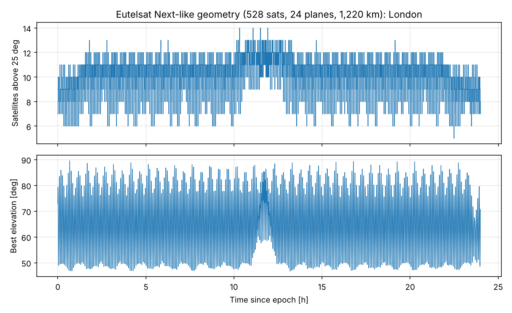
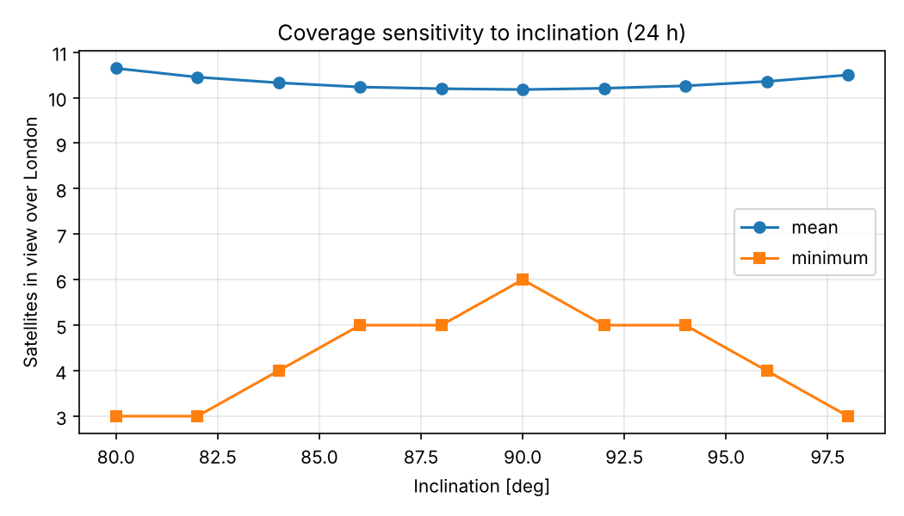
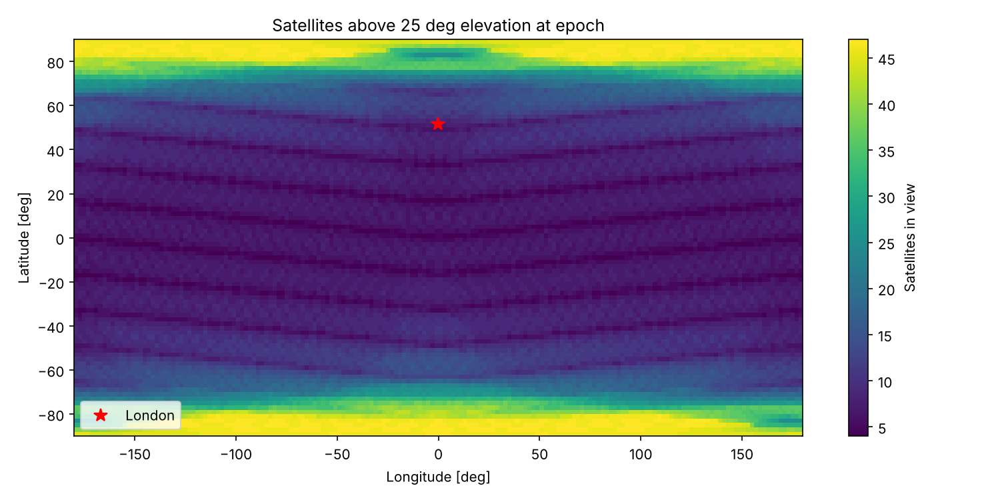

# LEO constellation coverage simulator

A validated Python model of a large low Earth orbit (LEO) broadband constellation. It propagates every satellite with the J2 perturbation, generates Walker constellation layouts and works out how many satellites a user on the ground can see.

The baseline case uses the public geometry from Eutelsat's July 2026 FCC filing for **Eutelsat Next**: 528 satellites in 24 orbital planes at 1,220 km. This is an independent study based on public information only. It is not Eutelsat's design or data.

## In plain English

Low Earth orbit satellites move fast, so no single satellite stays over London for long. A broadband constellation only works if, at every moment, enough satellites are high enough in the sky for a user terminal to connect. This model checks that. With 528 satellites, a terminal in London that needs a satellite at least 25 degrees above the horizon sees about 10 at any time, never fewer than 5 over a full day.

## Results (baseline, 25 deg elevation mask, 24 h at 30 s steps)

| Quantity | Value |
| --- | --- |
| Footprint half-angle per satellite | 15.5 deg (Earth central angle) |
| Satellites in view over London: mean | 10.2 |
| Satellites in view over London: minimum to maximum | 5 to 14 |
| Time with at least one satellite in view | 100% |
| Mean best available elevation over London | 65.6 deg |



The inclination is not given in the filing, so it is treated as a variable. The mean count over London barely changes between 80 and 98 deg, but the **worst case** does: the minimum number in view peaks at 6 for a polar orbit and falls to 3 at the edges of the sweep. A designer sizing for the worst moment, not the average, would care about that.



Polar constellations crowd together near the poles, which shows up clearly in a global snapshot:



## Method

1. **Constellation layout:** Walker star pattern (planes spread over 180 deg of right ascension, as used for near-polar systems), with a Walker delta option.
2. **Propagation:** two routes.
   - Numerical: two-body plus J2 acceleration, integrated with SciPy `solve_ivp` (DOP853). Used for single satellites and validation.
   - Analytic secular J2: right ascension of the ascending node and argument of latitude advanced at their mean J2 rates. Fast enough for the whole constellation at once.
3. **Frames:** ECI positions rotated to Earth-fixed coordinates; ground sites on the WGS-84 ellipsoid; elevation measured from the local geodetic vertical.
4. **Coverage:** count of satellites above the elevation mask, for one site over time and for a global grid at one instant.

## Validation

Every check below runs automatically as a unit test (`pytest`) on each change.

| Check | Expected | Model |
| --- | --- | --- |
| Orbital period at 1,220 km | Hand formula, 109.9 min | Exact match |
| Two-body orbit closes after one period | 0 m | 0.0001 m |
| Two-body energy over 24 h | Constant | Relative drift 3e-11 |
| J2 nodal drift, ISS-type orbit (numerical vs analytic) | -4.95 deg/day | -4.97 deg/day (0.4%) |
| Secular vs numerical over one orbit: radial / cross-track | Small | 6.8 km / 0.3 km |
| Satellite overhead | 90 deg elevation | 90 deg |
| Satellite at footprint edge | 25 deg elevation | 25 deg |
| Area-weighted global mean in view (geometry-independent result) | 9.56 | 9.68 (1.2%) |

## Assumptions and limitations

- **Inclination:** 87.9 deg is an assumption (close to the current OneWeb fleet), not a filed value. See the sweep above.
- **Elevation mask:** 25 deg is an assumed user-terminal limit.
- **Along-track drift:** the secular model treats the initial elements as mean elements, while the numerical model starts from osculating ones. Their periods differ slightly, so an along-track offset grows by about 80 km per orbit. Planes and radii still agree closely, so coverage statistics are unaffected, but satellite timing would be. Converting osculating to mean elements (Brouwer or Kozai theory) would fix this.
- **Earth rotation:** a simple rotation at a constant rate, with no precession, nutation or polar motion.
- **Geometry only:** no link budget, gateway visibility, inter-satellite links, satellite outages or beam capacity yet.

## Next steps

- [ ] Link budget layer: path loss against elevation for the Ku-band user and Ka-band gateway links, then throughput per beam
- [ ] Osculating to mean element conversion to remove the along-track drift
- [ ] Cross-check one satellite's ground track against NASA GMAT
- [ ] Coverage statistics over time for the global grid
- [ ] Julia version of the propagator, with a speed comparison

## Run it

```bash
pip install -e ".[test]"
pytest                          # run the validation suite
python scripts/run_analysis.py  # regenerate figures and figures/results.json
```

## Project layout

```
leo_coverage/
  constants.py      WGS-84 and gravity constants
  orbits.py         elements to state, numerical and secular J2 propagation
  constellation.py  Walker constellations and the baseline geometry
  frames.py         ECI to ECEF, geodetic sites, elevation angles
  coverage.py       site and global coverage analysis
scripts/run_analysis.py   baseline study and figures
tests/                    validation suite
```

## Background

This grew out of my undergraduate rotating space station design project, where I wrote a two-body propagator for the station's orbit and listed J2 as future work. This project adds J2, scales the propagator to a full constellation and adds the coverage analysis.

## Source for the baseline geometry

Payload Space, "FCC Filings Show Eutelsat is Working on a New 528-sat Constellation Beyond OneWeb" (July 2026).

Author: Emmanuel Airiofolo
